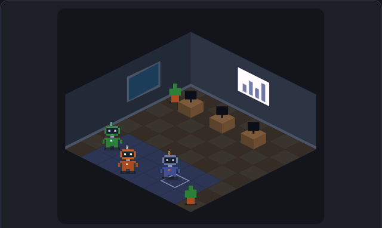
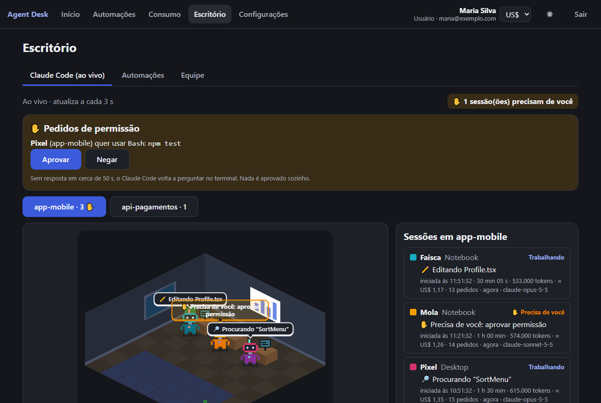
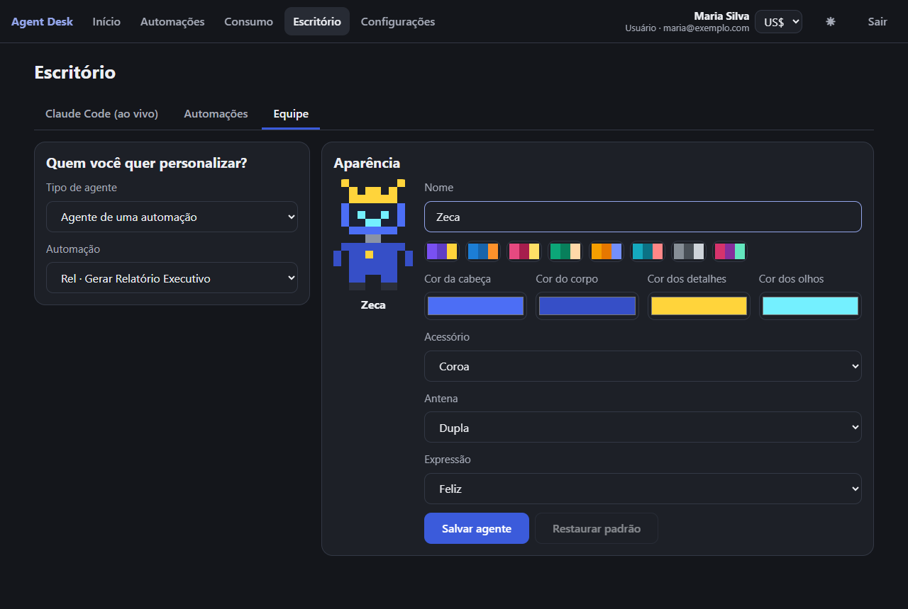
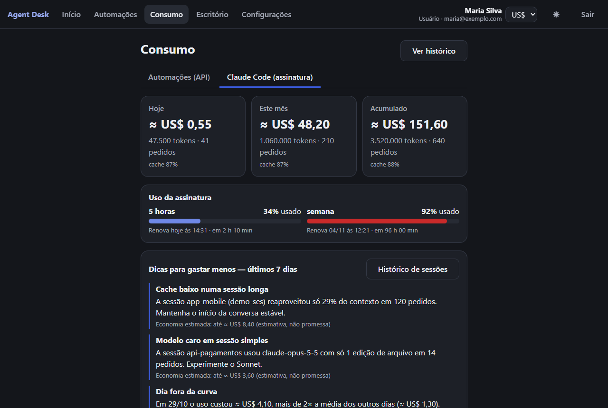

# AgentDesk

Painel de **consumo e automações com a API da Claude**, com um **escritório animado** onde cada agente é um robô — e acompanhamento ao vivo
das suas sessões do **Claude Code** (o que cada uma está fazendo, tokens, custo, e Parar/Aprovar/Negar pelo app).

> Projeto independente. Não é um produto oficial da Anthropic; "Claude" é marca da Anthropic.

## O que faz
- **Automações** (resumir, analisar código, relatório…) chamando a Claude com a **sua** chave da API — a chave fica **cifrada** no seu banco e nunca volta para o navegador.
- **Consumo**: tokens e custo de hoje, do mês e acumulado, gráfico por dia, ranking, histórico com o resultado de cada chamada, limite mensal.
- **Escritório animado** (pixel art desenhada por código): cada automação e cada sessão do Claude Code vira um robô, com nome e visual que você personaliza.
- **Claude Code ao vivo** (assinatura Pro/Max): um coletor leve no seu PC manda só **metadados** (nome da pasta, ferramenta, tokens) — nunca código nem prompts.
  Painel de tokens por projeto e modelo, taxa de cache, dicas para gastar menos, histórico de sessões, barras de uso de 5 h e da semana.
- **Controle**: **Parar** uma sessão e **Aprovar/Negar** pedidos de permissão pelo app (sem resposta, o Claude Code pergunta no terminal — nada é aprovado sozinho).
- **Moedas**: valores em US$, R$, € ou £ (cotação PTAX do Banco Central).

## Telas
*(Capturas do modo demonstração, com dados fictícios.)*



**Claude Code ao vivo** — cada sessão é um robô; pedidos de permissão para aprovar ou negar pelo app:



**Equipe** — nome e aparência de cada agente, com pré-visualização:



**Consumo do Claude Code** — tokens, ≈ custo, taxa de cache, barras de 5 horas e da semana e dicas para gastar menos:



## Rodar por conta própria (Docker)
```bash
cp .env.example .env          # preencha POSTGRES_PASSWORD e JWT_CHAVE_SECRETA
docker compose -f docker-compose.selfhost.yml up -d --build
```
Abra `http://localhost:8080`, crie a conta e cadastre a sua chave da Anthropic em **Configurações**. Para virar administrador:
`database/manutencao/promover-admin.sql`. Guia completo (HTTPS, atualização, backup, coletor do Claude Code):
[`docs/obsidian/Rodar por Conta Própria.md`](docs/obsidian/Rodar%20por%20Conta%20Pr%C3%B3pria.md).

## Privacidade e segurança
- Cada pessoa usa a própria chave da Anthropic; ela é cifrada (Data Protection) e nunca exibida de volta.
- O coletor do Claude Code envia **só metadados**; o código-fonte e o texto dos prompts não saem do seu computador.
- Reporte vulnerabilidades em privado: veja [SECURITY.md](SECURITY.md). Para contribuir: [CONTRIBUTING.md](CONTRIBUTING.md).

## Para quem desenvolve
Monólito modular **.NET 8 + Dapper + PostgreSQL 16** e app **Angular 22 PWA**. As regras de arquitetura estão no [CLAUDE.md](CLAUDE.md) e a
documentação num cofre do **Obsidian** em `docs/obsidian` (entrada: `00 - Dashboard.md`).

### Rodar local (desenvolvimento)
Primeiro copie `src/Host/AgentDesk.API/appsettings.Development.example.json` para `appsettings.Development.json` (fica fora do Git: pode pôr ali a sua connection string).
```bash
docker compose up -d                        # PostgreSQL já com o schema (+ pgAdmin :5050, Mailpit :8025)
dotnet run --project src/Host/AgentDesk.API    # API (https://localhost:52480) E o app (http://localhost:4210) juntos
```
No Visual Studio: perfil **"AgentDesk (API + App)"** + F5. Só a API: perfil "AgentDesk.API (somente API)" (abre o Swagger).
Só o app, sem backend: `cd src/AgentDesk.Web && npm run start:mock`. Detalhes: `docs/obsidian/Ambiente Local (API + App).md`.

Testes: `dotnet test` (backend) · `cd src/AgentDesk.Web && npm test && npm run e2e` (app).

## O que já vem pronto
| Peça | Onde |
|---|---|
| Núcleo: `Result/Error`, CQRS leve + validação, `IModule`, HTTP `problem+json` | `src/BuildingBlocks/AgentDesk.SharedKernel` |
| Npgsql + Dapper + health check + JWT | `src/BuildingBlocks/AgentDesk.Infrastructure` |
| Host: módulos, rate limit, CORS, Swagger, proxy reverso, schema no deploy sem travar o `/health`, **SPA Proxy** e fallback do app | `src/Host/AgentDesk.API` |
| Módulo **Contas**: cadastro, login e `GET /auth/eu` | `src/Modules/Contas` |
| Módulos **Configuracoes**, **Automacoes** e **Consumo** (Configuracoes é a referência para copiar) | `src/Modules/*` |
| **App Angular PWA**: login/cadastro, guards por perfil, tema claro/escuro, aviso de nova versão, mock de API, features Configurações e Automações | `src/AgentDesk.Web` |
| Testes: integração (API + PostgreSQL reais), Vitest e Playwright | `tests/`, `src/AgentDesk.Web` |
| Docker (API + app numa imagem), Railway, CI no GitHub Actions | `Dockerfile`, `railway.json`, `.github/workflows/ci.yml` |
| Cofre Obsidian: Dashboard, padrões, receitas, ADRs, modelos e perguntas-chave | `docs/obsidian` |

## Criar um módulo novo
Siga `docs/obsidian/Receita - Novo Módulo (API + App).md` (banco → API → testes → app → mock/E2E → nota).

## Deploy
`docs/obsidian/Deploy (Railway).md` (um serviço por branch; a imagem já leva o app em `wwwroot`).


## Licença
**GNU Affero General Public License v3.0** (AGPL-3.0) — veja o arquivo [LICENSE](LICENSE). Em resumo:
- Pode usar, estudar, modificar e rodar por conta própria, de graça, inclusive em empresa.
- Se você oferecer uma versão modificada como **serviço pela internet**, precisa publicar o código das suas modificações sob a mesma licença.
- Quer usar sem essas obrigações (por exemplo, embutir num produto fechado)? Fale com o mantenedor sobre uma licença comercial.

Copyright (C) 2026 Marcelo Lima.
